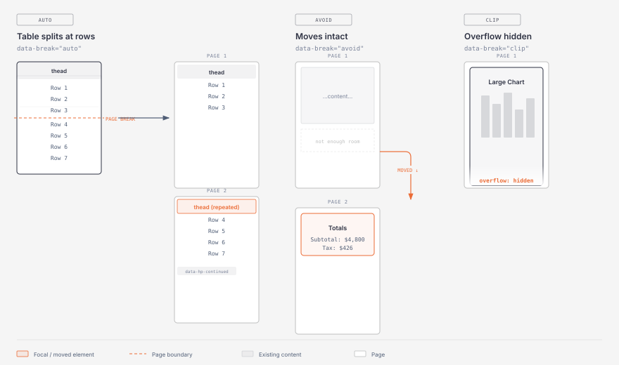
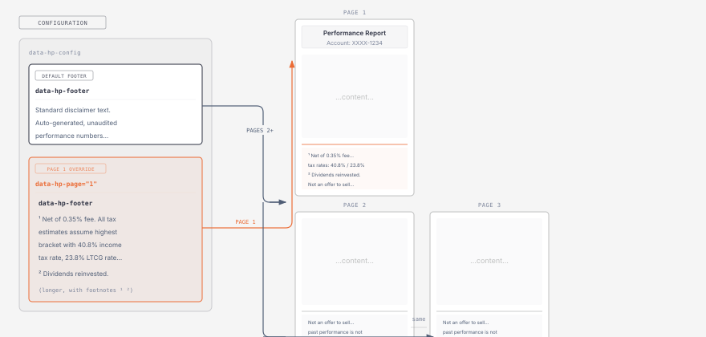
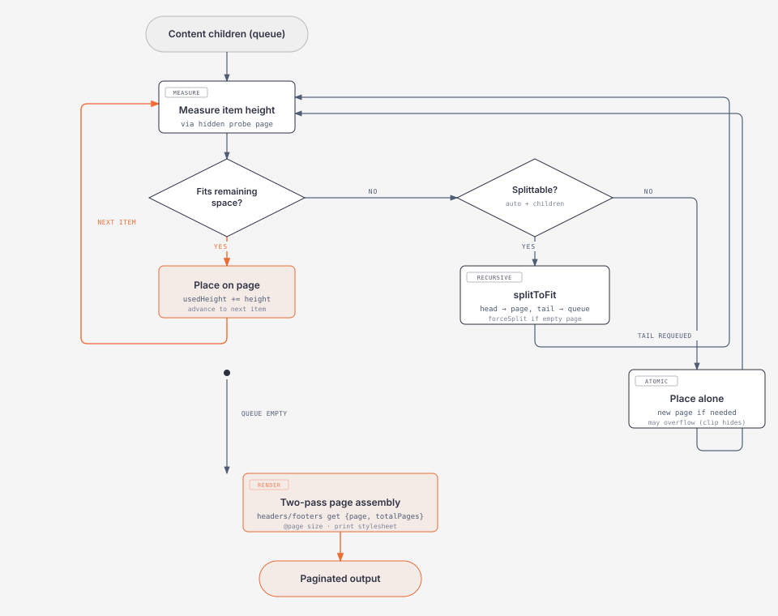

# html-paginator

Auto page-break pagination for HTML content. Distributes DOM elements across fixed-size pages with per-page headers, footers, and break control -- targeting `@media print` and headless PDF generation.

Zero runtime dependencies. Ships ESM, CJS, and TypeScript declarations.

## Install

```bash
npm install html-paginator
```

## Quick start

### Declarative (zero JS)

Define page config in a `<template>` and mark the content wrapper. Pagination triggers automatically on print (Cmd+P / Ctrl+P) and reverts when the print dialog closes.

```html
<script type="module" src="html-paginator/auto"></script>

<template data-hp-config data-hp-size="letter" data-hp-margin="0.6in">
  <div data-hp-header>Report — Page {{page}} of {{totalPages}}</div>
  <div data-hp-footer>{{page}} / {{totalPages}}</div>

  <!-- Override page 1: different header, no footer -->
  <div data-hp-page="1" data-hp-margin="1in">
    <div data-hp-header><h1>Cover Page</h1></div>
    <div data-hp-footer="none"></div>
  </div>
</template>

<div data-hp-content>
  <p>Your content here...</p>
  <table data-break="auto">...</table>
  <div data-break="avoid">Keep this block together</div>
</div>
```

### JavaScript API

```js
import { createPaginator } from 'html-paginator';

const paginator = createPaginator({
  source: '#content',
  page: {
    size: 'letter',
    margin: '0.6in',
    header: ({ page, totalPages }) =>
      `<div class="header">Page ${page} of ${totalPages}</div>`,
    footer: ({ page, totalPages }) =>
      `<div class="footer">${page} / ${totalPages}</div>`,
  },
  pageOverrides: {
    1: { header: '<h1>Cover</h1>', footer: null },
  },
  repeatTableHead: true,
});

const { pages, totalPages } = paginator.paginate();
// paginator.reset()  -- restore the original content
```

## Headless PDF generation (Puppeteer)

Headless Chrome's `page.pdf()` does **not** fire `beforeprint`. Call `window.htmlPaginator.run()` before generating the PDF:

```js
import puppeteer from 'puppeteer';

const browser = await puppeteer.launch();
const page = await browser.newPage();
await page.goto(url);

// Trigger pagination (declarative auto entry exposes this on window)
await page.evaluate(() => window.htmlPaginator.run());

await page.pdf({
  path: 'output.pdf',
  preferCSSPageSize: true,  // use the library's @page size
  printBackground: true,
});
await browser.close();
```

For the JS API, call `paginator.paginate()` directly (pagination is synchronous) -- no special handling needed.

## Content break control

Add `data-break` to content elements to control how they split across pages:

<p align="center">
  
</p>

| Value | Behavior |
|-------|----------|
| `auto` | Default. Content can split at child boundaries. Tables split at row level. |
| `avoid` | Keep the entire element on one page. If it doesn't fit on the current page, it moves intact to the next page. |
| `clip` | Like `avoid`, but applies `overflow: hidden` when the element exceeds a full page height. |

```html
<table data-break="auto">...</table>         <!-- rows split across pages -->
<div data-break="avoid">...</div>            <!-- never split -->
<div data-break="clip">...</div>             <!-- never split; clips if too tall -->
```

**Grouping elements together:** Wrap a heading + its chart/table in a `<div data-break="avoid">` to prevent the heading from orphaning at the bottom of a page while the content moves to the next:

```html
<div data-break="avoid">
  <h4>EXHIBIT 1. Revenue by Quarter</h4>
  <div class="chart-wrapper">
    
  </div>
</div>
```

**Rules:**
- Nested `avoid`/`clip` is not supported -- the outer value wins and a console warning is emitted.
- Paragraphs (elements holding text, e.g. `<p>Hello <b>world</b></p>`) split between lines, like Word. See [Paragraph splitting](#paragraph-splitting).
- Other leaf elements (no child elements, no text, e.g. images) are atomic and never split.
- CSS `break-inside: avoid` (or legacy `page-break-inside: avoid`) works like `data-break="avoid"`, unless the element sets `data-break` itself.
- Loose text placed directly in the content wrapper is wrapped in a `<div>` and paginated like any other block.
- Elements without `data-break` default to `auto` (splittable at child boundaries).

### Paragraph splitting

A paragraph that does not fit is split between lines, as in Word. The first lines fill the page, and the rest continue at the top of the next page:

- **Widow/orphan control:** at least 2 lines stay at the bottom of a page and at least 2 move to the next. Change these with the standard CSS `orphans` / `widows` properties, e.g. `p { orphans: 3; widows: 3 }`. If no split respects them, the paragraph moves whole.
- Lines are found where the paragraph is really laid out, inside its containers and at the page width. Inline formatting (`<b>`, `<a>`, `<br>`, …) is kept on both sides.
- The continuation has no first-line indent and no top margin, and the head has no bottom margin. In justified text, the head's last line is justified too.
- Keep a paragraph whole with `data-break="avoid"` or `break-inside: avoid`. Turn splitting off everywhere with `splitParagraphs: false`.
- Only elements with inline content are split. Paragraphs containing blocks or inline-blocks move whole.

### Forced page breaks

Start content on a new page, like Word's page break (Ctrl+Enter):

```html
<h2 data-break-before="page">Chapter 2</h2>          <!-- starts a new page -->
<p data-break-after="page">End of section.</p>        <!-- next content starts a new page -->
```

Standard CSS works too, from stylesheets or inline styles: `break-before` / `break-after` with `page`, `left` or `right`, and the legacy `page-break-before` / `page-break-after: always`:

```css
h2.chapter { break-before: page; }
```

- Breaks apply at any depth: containers and tables (at a row) are split where the break is.
- A break never creates a blank page. A break at the top of a page does nothing.
- Breaks inside `data-break="avoid"`/`"clip"` elements are ignored, because those elements are never split.
- The print stylesheet cancels these breaks inside generated pages, since pagination has already applied them. Without that, the browser would start extra sheets when printing.

### Keep with next

Keep an element on the same page as the element after it, like Word's "Keep with next". It stops headings and lead-in lines from being stranded at the bottom of a page:

```html
<p data-keep-with-next>The following table lists…</p>
<table>…</table>
```

- **Headings (`h1`–`h6`) keep with next by default**, as in Word. Opt one out with `data-keep-with-next="false"`, or turn the default off with `keepHeadingsWithNext: false`.
- The standard CSS spelling works too: `break-after: avoid` (or legacy `page-break-after: avoid`).
- When the next element has to start a new page, kept elements move with it, including chains such as a heading followed by a subheading. Inside a split container, a kept child moves to the next fragment.
- Moving never empties a page. If the kept elements fill the page by themselves, they stay put.

## Page configuration

### Size presets

`letter` (default), `legal`, `a4`, `a5` -- or pass explicit dimensions:

```js
{ size: { width: '210mm', height: '297mm' } }
```

In declarative mode: `data-hp-size="a4"` or `data-hp-size="210mm 297mm"`.

### Margin

Any CSS margin shorthand:

```js
{ margin: '0.6in' }
{ margin: '10mm 20mm' }
```

In declarative mode: `data-hp-margin="0.6in"`.

### Headers and footers

In the JS API, `header` and `footer` accept:

- **Template function**: `({ page, totalPages, pageLabel, ... }) => '<div>...</div>'` (see [Page numbers](#page-numbers))
- **HTML string**: `'<div class="header">Static header</div>'`
- **HTMLElement**: a DOM element (cloned per page)
- **CSS selector**: matches a `<template>` or element in the document
- **`null`**: explicitly removes the header/footer (useful in `pageOverrides`)

In declarative mode, the same context fields are interpolated in the template HTML: `{{page}}`, `{{totalPages}}`, `{{pageNumber}}`, `{{pageLabel}}`, `{{lastPageNumber}}` and `{{lastPageLabel}}`.

### Page numbers

Template functions receive the page context:

| Field | Meaning |
|-------|---------|
| `page` / `totalPages` | Physical page index (1-based) and page count |
| `pageNumber` / `pageLabel` | Displayed number and its formatted label |
| `lastPageNumber` / `lastPageLabel` | Same for the last page of the numbering run, for "Page X of Y" |
| `section` / `sectionPage` / `sectionPages` | Section name, page index within it, and its page count |

Set the start number and style with `pageNumbers`, like Word's "Format Page Numbers":

```js
createPaginator({
  source: '#content',
  // Cover is page 0, so page 2 reads "1", and "of" counts only numbered pages.
  pageNumbers: { start: 0, format: 'decimal' },
  page: { footer: ({ pageLabel, lastPageLabel }) => `<div>Page ${pageLabel} of ${lastPageLabel}</div>` },
  pageOverrides: { 1: { footer: null } },
});
```

Formats: `'decimal'` (default), `'lower-roman'` / `'upper-roman'` (i, ii, … / I, II, …), `'lower-alpha'` / `'upper-alpha'` (a … z, aa, bb, as in Word), or a function `(n) => string`. Numbers a format can't express (zero, negative numbers, roman above 3999) are shown as decimal.

Declaratively: `data-hp-page-start="0"` and `data-hp-page-format="lower-roman"` on the config (or content) element.

### Per-page overrides

Override any page property for specific pages (1-based). Omitted properties inherit from the default. This is how you get different headers or footers on page 1 vs. the rest -- a common requirement for cover pages, footnotes, and org-specific disclaimers.

<p align="center">
  
</p>

**JS API:**

```js
pageOverrides: {
  1: { margin: '1in', header: '<h1>Cover</h1>', footer: null },
  2: { header: '<div>Slim header</div>' },
}
```

**Declarative:**

```html
<template data-hp-config data-hp-size="letter" data-hp-margin="0.6in">
  <!-- Shared: applies to all pages by default -->
  <div data-hp-header>Default header — {{page}}</div>
  <div data-hp-footer>Standard disclaimer text.</div>

  <!-- Page 1 override: different footer with footnotes, no header change needed -->
  <div data-hp-page="1" data-hp-margin="1in">
    <div data-hp-footer>¹ Net of fees. ² Dividends reinvested. Full disclaimer...</div>
  </div>

  <!-- Page 2 override: slim header, inherits the shared footer -->
  <div data-hp-page="2">
    <div data-hp-header>Slim header</div>
  </div>
</template>
```

**Key behaviors:**
- A page override only replaces the properties it declares -- omitted slots inherit from the shared default.
- `data-hp-footer="none"` explicitly removes the footer for that page (useful for full-bleed cover pages).
- Footer/header height can vary per page -- the available body height is recomputed automatically, so content distributes correctly even when page 1 has a taller footer than pages 2+.

### Different first page, odd & even pages

Word's "Different First Page" and "Different Odd & Even Pages":

```js
createPaginator({
  source: '#content',
  pageNumbers: { start: 0 },                       // unnumbered cover
  page: {
    margin: '1in 0.75in 1in 1.25in',               // odd pages: inside margin on the left
    footer: ({ pageLabel, lastPageLabel }) => `<div>Page ${pageLabel} of ${lastPageLabel}</div>`,
  },
  firstPage: { header: null, footer: null, margin: '2in 1in' },
  oddPages: { header: '<div class="right">Chapter title</div>' },
  evenPages: {
    header: '<div class="left">Book title</div>',
    margin: '1in 1.25in 1in 0.75in',               // mirrored margins
  },
});
```

- Layers are applied in this order, later ones winning: `page` → `oddPages` / `evenPages` → `firstPage` → `pageOverrides[n]`. Each layer replaces only the properties it declares, and `null` removes a header or footer.
- As in Word, odd/even follows the **displayed** page number. With `pageNumbers: { start: 0 }`, the page after the cover shows "1" and is odd.
- Declaratively: `data-hp-page="first"`, `"odd"` or `"even"` groups (next to numbered groups) in the config template.

### Sections

Word's section breaks: parts of a document with their own numbering and headers/footers. Typical use: front matter numbered i, ii, iii, then a body that restarts at 1, with each chapter starting on a right-hand page.

```html
<div data-section="front">…table of contents, preface…</div>
<section data-section="body">…chapter 1…</section>
<section data-section="chapter">…chapter 2…</section>
<section data-section="chapter">…chapter 3…</section>
```

```js
createPaginator({
  source: '#content',
  page: {
    footer: ({ pageLabel, lastPageLabel }) => `<div>${pageLabel} / ${lastPageLabel}</div>`,
    header: ({ section, sectionPage }) => `<div>${section} · ${sectionPage}</div>`,
  },
  firstPage: { header: null, footer: null },                 // cover
  sections: {
    front: { pageNumbers: { start: 1, format: 'lower-roman' } },
    body: { pageNumbers: { start: 1 }, start: 'odd' },       // restart at 1, right-hand page
    chapter: { start: 'odd' },                               // continue numbering
  },
});
```

- `data-section="name"` starts a new section and implies a page break. A name can repeat: each occurrence starts a new section that uses the same settings.
- A section's `page`, `oddPages` and `evenPages` merge over the top-level ones, like Word's "Link to Previous". Its `firstPage` applies to the section's own first page.
- `pageNumbers.start` restarts numbering. Without it, numbering continues from the previous page. The `format` falls back to the top-level one.
- `start: 'odd' | 'even'` starts the section on the next odd or even **physical** page (right- or left-hand side in duplex printing), inserting a blank page when needed. The blank page belongs to the previous section.
- Templates also receive `section`, `sectionPage` and `sectionPages`. `lastPageNumber` / `lastPageLabel` refer to the last page of the current numbering run, so "Page X of Y" works inside a restarted body.
- Declaratively: `<div data-hp-section="name">` groups in the config template, with their own header/footer slots, `data-hp-margin`, `data-hp-page-start`, `data-hp-page-format`, `data-hp-section-start="odd"`, and nested `data-hp-page="first|odd|even"` groups.

### Table of contents and page references

Word's TOC and PAGEREF fields. Mark a container with `data-hp-toc` and it is filled with one entry per heading: the heading text, a dot leader, and the page it lands on. Any element with `data-hp-page-ref` shows the page of its target:

```html
<nav data-hp-toc data-hp-toc-levels="1-2">
  <h2>Contents</h2>
</nav>
…
<p>Details are on page <a href="#results" data-hp-page-ref></a>.</p>
```

- Levels default to `1-3` (`h1`–`h3`). Include any element with `data-hp-toc-level="N"`, and leave a heading out with `data-hp-toc-skip`. Headings inside the TOC container are never listed.
- Page numbers are **page labels**: they follow the numbering format, restarts and sections (e.g. `iv` in front matter).
- The reference target is the attribute's value (`data-hp-page-ref="#id"`), or else the element's `href`. A target that does not exist shows `??` and logs a warning.
- Headings without an `id` get one (`hp-toc-N`) in the paginated copy, so entries link to them; the source is not modified.
- Entries are `div.hp-toc-entry.hp-toc-level-N`, each holding `a.hp-toc-text`, `span.hp-toc-leader` and `span.hp-toc-page`. The layout (flex, dotted leader, 1.5em indent per level) is set inline so it is measured correctly. Restyle them with your own CSS.
- Numbers are measured as `000` before they are known, so filling them in never changes the pagination.

## Table splitting

Tables with `data-break="auto"` split at row boundaries. The `<caption>` stays on the first fragment and `<tfoot>` goes on the fragment holding the last row (its height counts toward that page). Use `repeatTableHead` to repeat `<thead>` on continuation pages:

```js
createPaginator({ source: '#content', repeatTableHead: true });
```

Or declaratively: add `data-hp-repeat-table-head` on `<template data-hp-config>` or `<div data-hp-content>`.

Continuation fragments are marked with a `data-hp-continued` attribute for styling:

```css
table[data-hp-continued] { border-top: 1px dashed #ccc; }
```

## API reference

### `createPaginator(config: PaginatorConfig): Paginator`

Create a paginator instance.

**`PaginatorConfig`**

| Property | Type | Default | Description |
|----------|------|---------|-------------|
| `source` | `string \| HTMLElement` | *required* | Content wrapper (selector or element) |
| `target` | `string \| HTMLElement` | after source | Where to render paginated output |
| `page` | `PageConfig` | letter, no margin | Default page definition |
| `pageOverrides` | `Record<number, PageConfig>` | `{}` | Per-page overrides (1-based) |
| `repeatTableHead` | `boolean` | `false` | Repeat `<thead>` on table continuation pages |
| `splitParagraphs` | `boolean` | `true` | Split paragraphs between lines (widow/orphan control via CSS `orphans`/`widows`) |
| `keepHeadingsWithNext` | `boolean` | `true` | Headings keep with the next element |
| `injectStyles` | `boolean` | `true` | Inject built-in print/screen stylesheet |
| `measurer` | `MeasureAdapter` | DOM layout | Custom measurement adapter: `measure(el, page?)` (outer height of `el` on that page), `pageHeight(page)` (available body height), optional `layout(el, page, fn)` (run `fn` while `el` is laid out on that page; needed for paragraph splitting), optional `dispose()` |

**`Paginator`**

| Method | Returns | Description |
|--------|---------|-------------|
| `paginate()` | `{ pages, totalPages }` | Distribute and render pages |
| `reset()` | `void` | Remove pages and restore original content |
| `getConfig()` | `PaginatorConfig` | Current resolved configuration |

### `autoPaginate(doc?, overrides?): Paginator | null`

Parse declarative markup and paginate immediately. Returns `null` if no `data-hp-content` element exists.

### `bindPrintPagination(doc?, overrides?): PrintPaginationHandle`

Bind pagination to the print lifecycle. Returns a handle:

| Method | Description |
|--------|-------------|
| `run()` | Paginate now (what `beforeprint` triggers) |
| `reset()` | Restore original content (what `afterprint` triggers) |
| `unbind()` | Remove the print event listeners |

### `html-paginator/auto`

Side-effect import that calls `bindPrintPagination()` and exposes the handle as `window.htmlPaginator`. Use with declarative markup for zero-config pagination on print.

## Declarative attributes

| Attribute | Element | Description |
|-----------|---------|-------------|
| `data-hp-config` | `<template>` | Page configuration container (inert, never rendered) |
| `data-hp-content` | any | Content wrapper to paginate |
| `data-hp-header` | inside config | Header template. Set `="none"` to remove. |
| `data-hp-footer` | inside config | Footer template. Set `="none"` to remove. |
| `data-hp-page="N"` | inside config | Per-page override group: page number (1-based), or `first`, `odd`, `even` |
| `data-hp-size` | config or content | Page size preset or `"<width> <height>"` |
| `data-hp-margin` | config, content, or page group | CSS margin shorthand |
| `data-hp-repeat-table-head` | config or content | Repeat `<thead>` on split tables |
| `data-hp-page-start` | config or content | Number shown on the first page (default `1`) |
| `data-hp-page-format` | config or content | `decimal`, `lower-roman`, `upper-roman`, `lower-alpha`, `upper-alpha` |
| `data-break` | content elements | Break behavior: `auto`, `avoid`, or `clip` |
| `data-break-before` / `data-break-after` | content elements | `="page"` forces a page break |
| `data-keep-with-next` | content elements | Keep on the same page as the next element (`="false"` opts a heading out) |
| `data-hp-toc` | content container | Fill with a table of contents (`data-hp-toc-levels="1-3"`) |
| `data-hp-toc-level` / `data-hp-toc-skip` | content elements | Add an element to the TOC at a level / leave a heading out |
| `data-hp-page-ref` | content elements | Replace the text with the page label of `#id` (attribute value or `href`) |
| `data-section` | content elements | Start a new section (`sections[name]`); implies a page break |
| `data-hp-section` | inside config | Section layout group (slots, margin, numbering, nested first/odd/even groups) |
| `data-hp-section-start` | section group | `odd` / `even`: start on that side, inserting a blank page if needed |

## How it works

<p align="center">
  
</p>

The pipeline has two passes:

### Pass 1 -- Distribution (greedy first-fit)

1. **Measure** -- A hidden probe page with the same dimensions, margins, header, and footer is mounted in the document. Each content element is temporarily placed inside it to get an accurate height from the browser's layout engine. Available body height is computed per page (it varies when headers/footers differ).

2. **Distribute** -- Items are walked top-to-bottom, filling the current page until the next element doesn't fit. Order is always preserved; items are never reordered to fill gaps.

3. **Split or place** -- When an item doesn't fit:
   - **Splittable** (`data-break="auto"` with children): `splitToFit` recursively splits the container at child boundaries. The head fragment stays on the current page; the tail is re-queued for the next page. Tables split at row level with optional `<thead>` repetition. If no children fit an empty page, `forceSplit` takes the first (deepest splittable) child so pagination can continue.
   - **Paragraphs** (`auto` elements holding inline text): split between lines. Line boxes are found in the real layout, and the largest head within `orphans`/`widows` that fits stays on the page.
   - **Atomic** (`avoid`, `clip`, or leaf): the item is placed alone on a new page. If it exceeds the page height, it overflows in place (`overflows: true`). For `clip` items, `overflow: hidden` is applied to the page body.

### Pass 2 -- Rendering

4. **Build pages** -- Distribution determines the final page count. Pages are assembled as flex-column divs; headers and footers are rendered with complete `{ page, totalPages }` context. Continuation fragments are marked with `data-hp-continued`.

5. **Print stylesheet** -- An injected `@page` rule sets the CSS page size and zeroes browser margins, so the library's own margin configuration is authoritative. Each page gets `page-break-after: always`.

## Development

```bash
npm test            # unit tests (vitest + jsdom, stubbed layout)
npm run test:e2e    # real Chromium: layout, print and PDF checks (Playwright)
npm run typecheck
```

The e2e suite builds `dist/` first, then paginates `examples/invoice.html` and the fixtures in `e2e/fixtures/`. For each one it checks every page's size, that no content extends past a page body, that all content appears once and in order, and that each page of the printed PDF has the same content as its rendered page. Install the browser once with `npx playwright install chromium`.

## License

[MIT](LICENSE) © Jaeyoung Lee
